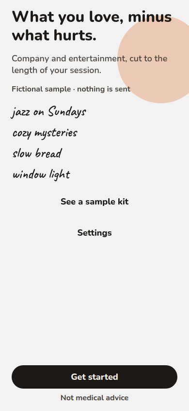
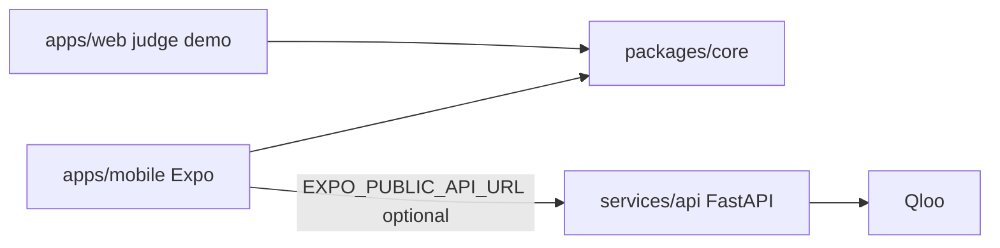

# Long Chair

[](.github/workflows/ci.yml)
[](LICENSE)
[](apps/mobile/package.json)
[](apps/web/tsconfig.app.json)

Company and entertainment for a long session. **What you love, minus what hurts, sized to the time you have.**



Someone names a few films, shows, books, podcasts, or records, how long the session is, and which themes should stay out of the room. Long Chair turns that into a timeline, says why each piece was kept, and prepares a small plan for the person sitting alongside.

This is the [Qloo Agentic Hackathon](https://qloo.devpost.com/) build. Judges use the web demo. The iPhone app is the TestFlight and App Store track. It is not medical advice.

## Features

- A full pass: welcome, one question at a time, an illustrated build, a ready stamp, a session kit, a piece sheet, a companion plan, and a plain-model contrast.
- A typed sample shelf. Length and tastes change what gets packed.
- Region chips follow the device locale (Mexico, the United States, Brazil, Spain, the United Kingdom, India, or Global). No location permission. A Region control can override it.
- Built-in themes are rules. A title is packed only when those rules verify clear. Compare shows the sample precision and recall. See [ADR 0009](docs/adr/0009-region-chips-and-theme-rules.md).
- Lengths come from a catalog runtime, an episode or album length, or a page-count estimate. Cards open in Apple, Open Library, Spotify search, or Maps. Nothing plays in the app. See [ADR 0010](docs/adr/0010-qloo-wire-and-enrichment.md).
- The sample is labeled. Nothing is sent in the review build. There is no account.
- Theme filters are content preferences kept on the phone.
- Liquid glass on iOS 26, with a blur fallback everywhere else.
- The Qloo key stays on the server. The phone never holds it.

## Architecture



The web demo still packs in memory. The phone uses the fixture adapter unless `EXPO_PUBLIC_API_URL` is set, and then it calls `POST /v1/sessions` and `POST /v1/sessions/{id}/plan`. Neither client calls Qloo.

## Tech stack

| Piece      | Stack                                                       |
| ---------- | ----------------------------------------------------------- |
| Web demo   | React 19, Vite, TypeScript strict, Tailwind 4               |
| iPhone app | Expo SDK 57, expo-router, React Native, TypeScript strict   |
| Shared kit | `packages/core`, Vitest, no framework                       |
| API        | Python 3.12, FastAPI, hexagonal ports, FakeQloo by default  |
| Store      | Entertainment, secondary Lifestyle. See `docs/app-store.md` |

## Quickstart

Node.js 22 or newer.

```bash
npm install
npm run dev
```

Web demo: [http://127.0.0.1:4179](http://127.0.0.1:4179).

```bash
npm run dev:mobile
```

Expo for web, port 4181. On a Mac, `npx expo start` inside `apps/mobile` opens a simulator.

API, with [uv](https://docs.astral.sh/uv/) 0.13 and Python 3.12:

```bash
cd services/api
uv sync --extra dev
uv run uvicorn app.api.main:app --host 127.0.0.1 --port 8099
```

Health is `GET /v1/health`. The demo kit is `POST /v1/demo/plan` with `{}`. Default mode is `fake`, so this works with no Qloo key.

Enrichment stays on the sample records unless `ENRICHMENT_MODE=live`. TMDB is used only when `TMDB_API_KEY` is set. `OPEN_LIBRARY=1` turns on the Open Library fallback. iTunes needs no key and is throttled. Spotify is a search link.

The live scope check is skipped unless a key is present. It writes a shape report to `services/api/.qloo-live/`, which is gitignored. Do not commit those files.

```bash
cd services/api
QLOO_API_KEY=... uv run python -m app.live.qloo_scope
QLOO_API_KEY=... uv run pytest tests/live -q --override-ini=addopts=
```

### Optional agent kit

`POST /v1/kit/agent` accepts the same draft, locality, and weekday body as
`POST /v1/sessions`. It returns `packed`, `items`, `topics`, `places`, and `source`,
plus `trace` and `termination`. Without a model key it uses the deterministic
builder and returns `trace: []`.

Set `LLM_API_KEY` (or `OPENAI_API_KEY`) and an explicit `LLM_MODEL` to enable native
tool calling. `LLM_BASE_URL` defaults to `https://api.openai.com/v1` and can point at
an OpenAI-compatible Chat Completions endpoint. Qloo and enrichment modes remain
fake by default, so the agent needs no Qloo key for a fictional run.

The server owns theme exclusions and always rechecks the final candidates. The
model cannot add item records, replace themes, or edit lengths. Default budgets
are eight tool calls/eight model turns, 20 seconds of exploration, and 10 seconds
for verified finalization/fallback. Server settings are `AGENT_MAX_STEPS` (1-32),
`AGENT_TIMEOUT_SECONDS` (positive, at most 120), and
`AGENT_FINALIZE_TIMEOUT_SECONDS` (positive, at most 60).

Trace entries expose `step`, `tool`, `argsSummary`, `resultCount`, `latencyMs`, and
`status`. Argument summaries contain field names and counts only. Termination is
`completed`, `step_limit`, `time_limit`, `provider_error`, or `no_key`. The existing
503 error envelope is returned if finalization cannot finish.

From `services/api`, run the fictional comparison without keys or network:

```bash
uv run python -m app.live.agent_metrics
```

It prints verifier pass rate, duration fit, type diversity, steps, and latency for
agent, deterministic, and LLM-only strategies. The default LLM-only row is a
scripted selection with an intentionally avoided fictional title; it is an
example of scoring, not a live result or a claim that one strategy is better.
`--live` requires `RUN_LIVE_AGENT=1`, `QLOO_API_KEY`, `LLM_API_KEY`, and `LLM_MODEL`.
Only opt in after approval to spend on calls. The live model-only baseline selects
from deterministic verified catalog titles without tools; it does not receive raw
Qloo documents. The script prints aggregate measures only. Live tests are skipped
unless the same opt-in and both keys exist.

See [ADR 0011](docs/adr/0011-agent-loop.md) and the
[agent validation guide](specs/005-agent-loop/quickstart.md) for request examples,
configuration, and tests.

Oscar's simulator pass is `docs/qa-checklist.md`.

### Install the web demo

The production web build is a progressive web app. The dev server does not register the worker.

```bash
npm run build
npm run preview
```

### TestFlight and App Store

Signed builds run on a Mac. This workspace cannot sign them.

```bash
npx eas-cli login
npx eas-cli build --platform ios --profile preview
npx eas-cli submit --platform ios --profile production
```

`apps/mobile/eas.json` has development, preview, and production. iOS build numbers auto-increment. Leave `EXPO_PUBLIC_API_URL` unset for review so the app stays on the sample shelf and collects nothing. Review notes, the privacy label, and the age-rating draft are in `docs/app-store.md`.

## Project structure

```text
apps/web/         Judge demo
apps/mobile/      Expo app, icon, splash, eas.json
packages/core/    Kit model, packer, copy, fixtures, KitService
services/api/     FastAPI session kit
specs/            Spec Kit features
docs/             Architecture, ADRs, App Store notes
```

## Screens

| Screen    | Web hash              | What you do                                               |
| --------- | --------------------- | --------------------------------------------------------- |
| Welcome   | `#/welcome`           | Promise, sample label, get started or open the sample kit |
| Tastes    | `#/love`              | What belongs in the room                                  |
| Length    | `#/chair`             | 1h, 2h, 3h, or 4h                                         |
| Themes    | `#/themes`            | What should stay out of the room                          |
| Company   | `#/company`           | Pick a guide                                              |
| Building  | `#/building`          | Five steps, then the kit                                  |
| Ready     | `#/ready`             | Stamp, then open the kit                                  |
| Kit       | `#/kit`               | Timeline                                                  |
| Piece     | `#/item/north-window` | Sheet over the kit                                        |
| Companion | `#/companion`         | Places and things to talk about                           |
| Contrast  | `#/compare`           | What a plain model would bring                            |
| Settings  | mobile only           | Disclaimer, sample label, on-device note                  |

## Roadmap

Judging deadline is 30 October 2026, 21:45 America/Mexico_City. The judge URL is the hosted web app. The iPhone app targets TestFlight and, once real catalog data is wired through the API, App Store review.

- Keep the fake adapter green.
- Wire the web screens to `/v1` through a typed client. They still must not call Qloo.
- Host the static demo and the API. The key lives only on the API host.
- Submit an English Devpost page. Say this is not medical advice.

Details: [roadmap](docs/plan/ROADMAP.md), [architecture](docs/architecture/ARCHITECTURE.md), [ADRs](docs/adr/), [mobile spec](specs/002-mobile-app/spec.md).

## Checks

| Script                | What it does                    |
| --------------------- | ------------------------------- |
| `npm run dev`         | Web demo on port 4179           |
| `npm run dev:mobile`  | Expo web on port 4181           |
| `npm run build`       | Web production build            |
| `npm run typecheck`   | Every workspace                 |
| `npm run lint`        | ESLint                          |
| `npm test`            | Vitest                          |
| `npm run doctor`      | expo-doctor                     |
| `npm run export:ios`  | iOS JavaScript bundle           |
| `npm run lint:slop`   | Design slop lint, informational |
| `npm run lint:slopmd` | SlopMD, informational           |

API checks, from `services/api`: `uv run ruff check .`, `uv run ruff format --check .`, `uv run mypy`, `uv run pytest`.

## Hackathon

Public repo, MIT in the About field, a hosted demo URL, an English description, and no Qloo payload. Fictional titles only. The comparison screen names one well-known book as the example of what an unfiltered model reaches for. No text from that work is included.

Refreshing the web demo restores the sample profile. Choices live in memory for the visit.

## License

[MIT](LICENSE). Nunito and Caveat remain under the SIL Open Font License.

Contributing: [CONTRIBUTING.md](CONTRIBUTING.md). Conduct: [CODE_OF_CONDUCT.md](CODE_OF_CONDUCT.md). Security: [SECURITY.md](SECURITY.md).
