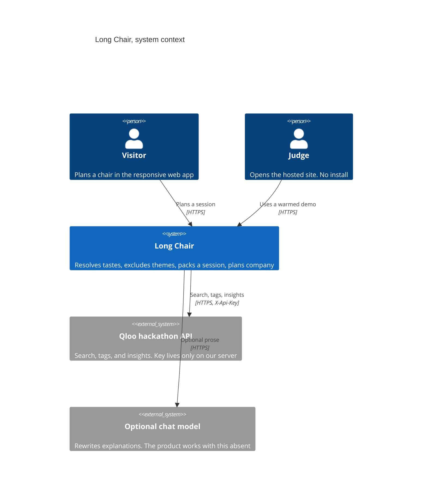
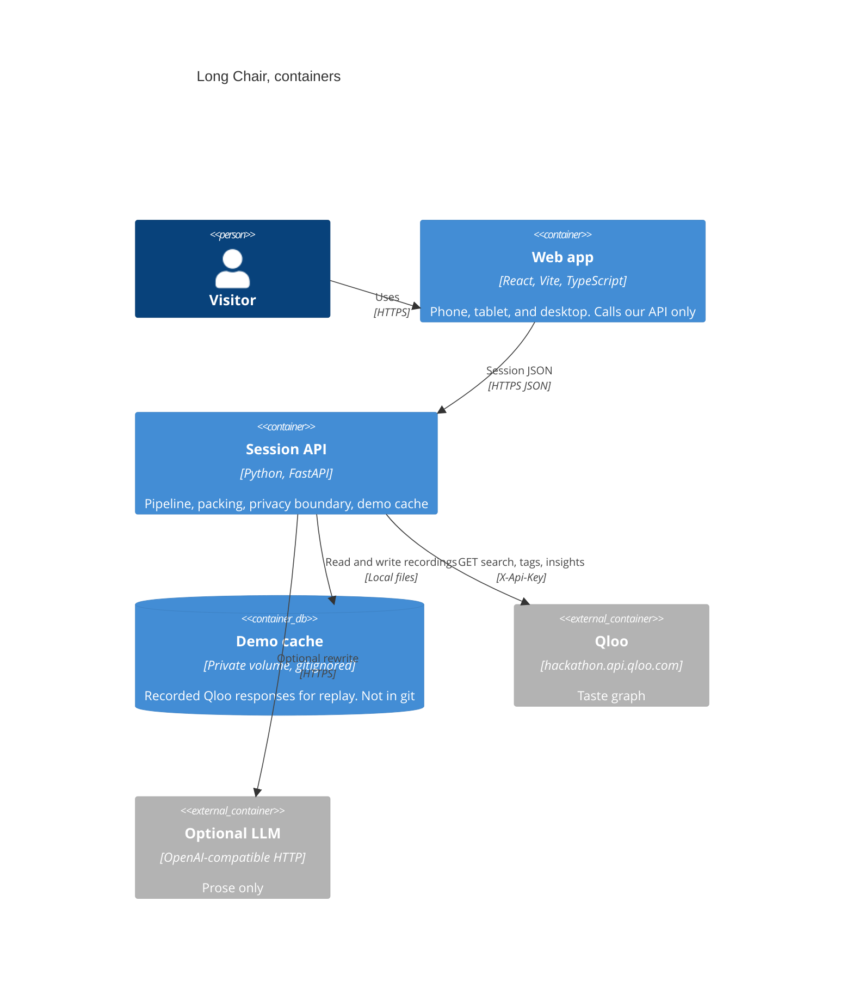
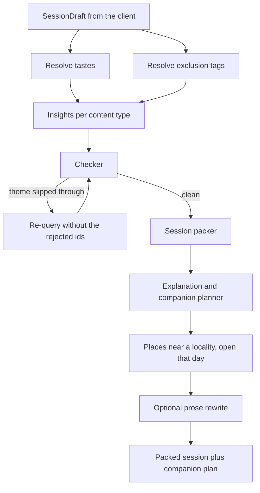
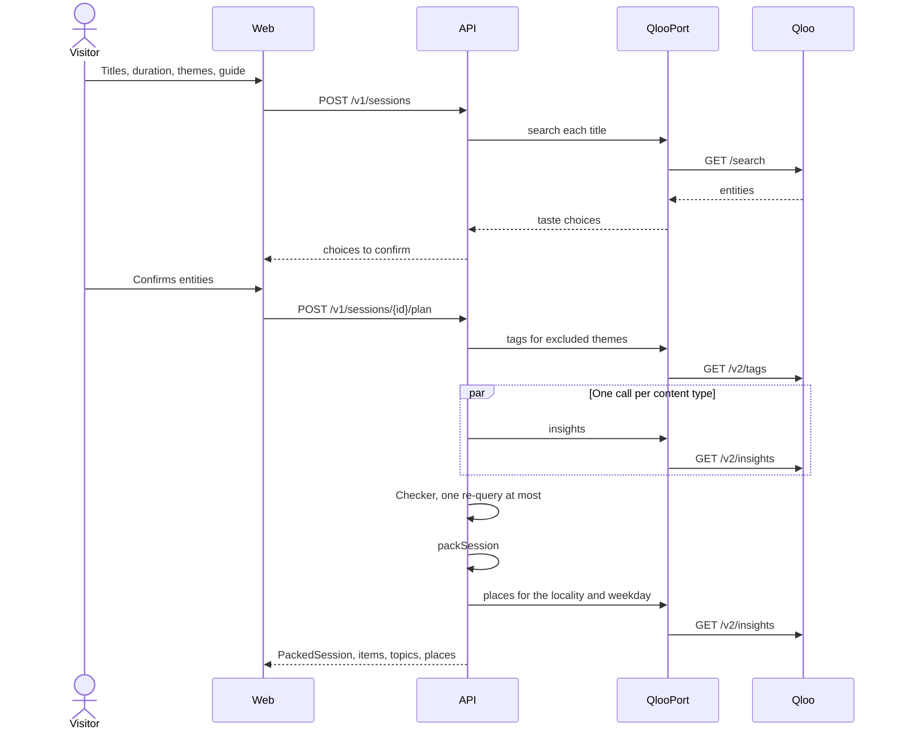
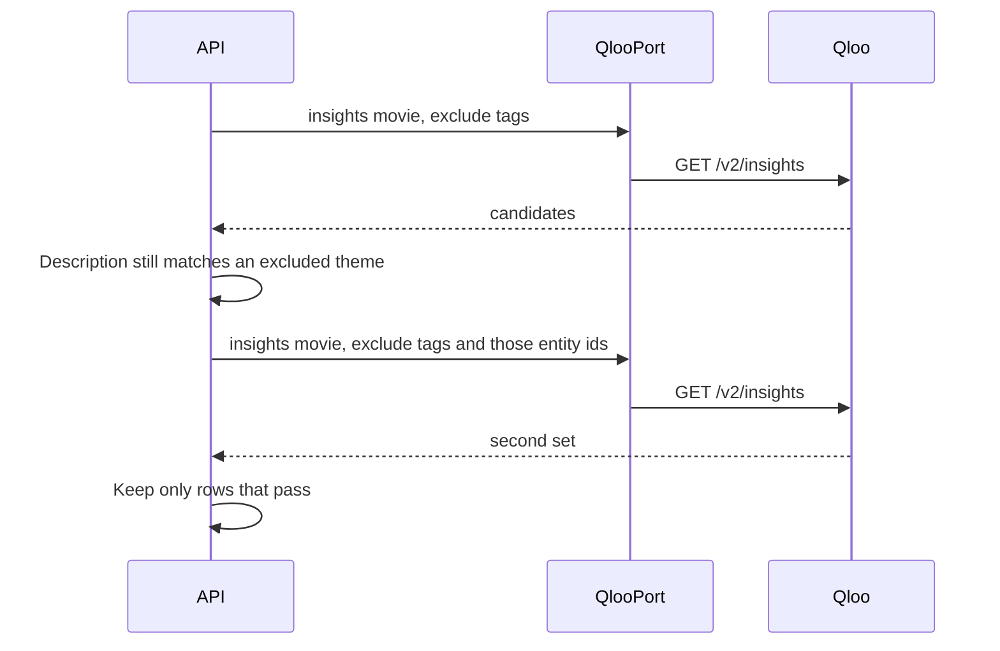
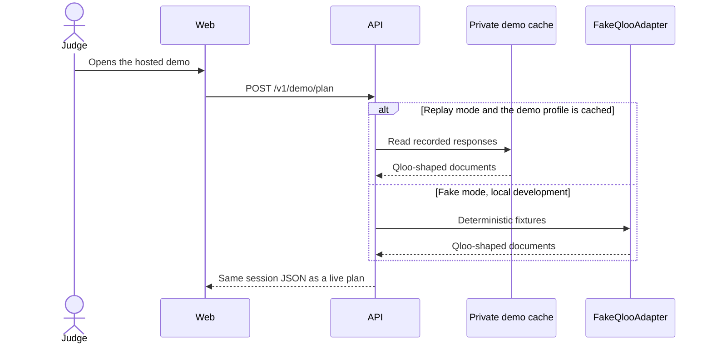

# Long Chair architecture

Status: the session-kit API is implemented behind `FakeQlooAdapter`. The Vite screens still use the in-memory sample shelf and are not wired to `/v1`. Adapter details live in [qloo-port.md](qloo-port.md). The choices that were close are the ADRs in `docs/adr/`. The calendar is [the roadmap](../plan/ROADMAP.md).

Deadline: 30 October 2026, 21:45 America/Mexico_City. The hosted demo has to keep working after the hackathon key is turned off, through judging. Nothing returned by Qloo is committed to this public repo.

## What we are building

A visitor names a few films, shows, books, podcasts, or records, how long the chair is, and which themes should stay out of the room. Long Chair asks Qloo for taste neighbors, drops anything carrying an excluded theme, fits the survivors to the clock, and prepares a short plan for the person sitting alongside: things to talk about, and places that are open nearby.

The prototype already shows that story. The hackathon build replaces the fictional shelf with Qloo, behind a server, without changing the screen types.

## Decisions

| Topic          | Choice                                                        | Where                                                                          |
| -------------- | ------------------------------------------------------------- | ------------------------------------------------------------------------------ |
| Backend        | Python, FastAPI                                               | [ADR 0001](../adr/0001-backend-fastapi.md)                                     |
| Language model | Optional, off by default; agent tool loop in ADR 0011         | [ADR 0002](../adr/0002-llm-optional.md), [ADR 0011](../adr/0011-agent-loop.md) |
| Hosting        | Static web app plus a small always-on API with a private disk | [ADR 0003](../adr/0003-hosting.md)                                             |
| Repo layout    | Monorepo. Vite app at the root, API in `services/api`         | [ADR 0004](../adr/0004-monorepo.md)                                            |
| Client         | Responsive web app. Swift is post-hackathon only              | [ADR 0007](../adr/0007-responsive-web-client.md)                               |
| Qloo access    | `QlooPort`, three adapters, shared contract tests             | [qloo-port.md](qloo-port.md)                                                   |

## System context



The browser never holds `QLOO_API_KEY` and never calls `hackathon.api.qloo.com`. Judges are the same system as visitors. Their path is allowed to be served from the private demo cache once the key is dead.

## Containers



There is no account database. A session lives in memory on the API, and the demo profiles live as files on the private volume. If the process restarts, the warmed demo files are still there. A visitor's own in-progress draft can be lost. That is acceptable for a hackathon demo.

## Agentic pipeline

The server runs this in order. The prototype animates five steps (`resolve`, `match`, `exclude`, `pack`, `check` in `src/lib/build-agent-steps.ts`). On the server the checker runs before packing, so a rejected title never occupies a slot. The screen may keep narrating "double-checking" last. That narration is not the server's order.



### 1. Resolve tastes

The visitor types a title. The API calls Qloo search and returns a short list of entities. The visitor picks one. We store the Qloo entity id on the server session and the prototype `TasteSeed` id on the draft the UI already understands.

Search, confirmed by a public hackathon staff example: `GET https://hackathon.api.qloo.com/search?query={text}&type={urn}` with header `X-Api-Key`. Example type: `urn:entity:movie`.

We do not send the visitor's name. The query is a cultural title.

### 2. Insights per content type

For each of `movie`, `tv_show`, `podcast`, `book`, and `artist`:

`GET https://hackathon.api.qloo.com/v2/insights`

Confirmed query parameters, from the Insights reference on docs.qloo.com:

| Parameter                   | Value we send                                                                                                        |
| --------------------------- | -------------------------------------------------------------------------------------------------------------------- |
| `filter.type`               | `urn:entity:movie`, `urn:entity:tv_show`, `urn:entity:podcast`, `urn:entity:book`, or `urn:entity:artist`            |
| `signal.interests.entities` | Comma-separated entity ids from resolve. Documented as a comma-separated list on GET, not a JSON array               |
| `filter.exclude.tags`       | Comma-separated tag ids for the themes the visitor left out                                                          |
| `operator.exclude.tags`     | `union`, so a hit on any excluded tag drops the entity. This is also the documented default                          |
| `feature.explainability`    | `true`                                                                                                               |
| `take`                      | A small integer. The documented maximum was not in the pages we read. Start at 20 and confirm on the first live call |

Calls for the five types run concurrently. Weighted signals need POST. Version 1 stays on GET.

A bad parameter comes back as an empty 200, not an error. The adapter validates every parameter before the request. An empty list after a validated request is a real miss. An empty list we cannot explain is a bug, logged, and not shown as "you have no taste."

### 3. Checker

For each candidate, read `properties.tags` and `properties.description` (both present on the documented movie sample). If a tag id is one we meant to exclude, or the description plainly matches a theme the visitor left out, reject it.

Rejection re-queries that content type once, adding the rejected ids in `filter.exclude.entities` (the parameter exists on the documented per-type lists). The second pass goes through the checker again. Anything that fails twice is dropped. We do not loop.

The checker is deterministic rules in version 1. A model may later suggest a rejection, and the rules still have to agree. The model does not get a veto the rules do not share. See [ADR 0002](../adr/0002-llm-optional.md).

### 4. Session packer

`packSession` in `src/lib/pack-session.ts` stays the fitter. It reads tastes, themes, and minutes. It does not read `companionId`. The API calls the same rules. Durations that Qloo does not return use the fallbacks in [qloo-port.md](qloo-port.md). Those fallbacks are marked unconfirmed and get replaced when a live payload shows a real field.

### 5. Explanation and companion planner

Explainability, from the Insights reference: with `feature.explainability=true`, each result includes a `query.explainability` section naming which input entities contributed, with scores from 0 to 1. Scores at or above 0.1 are always included. A top-level `query.explainability` averages influence across top-N slices. If it cannot be computed, `query.explainability.warning` is set and the results still return.

The exact keys inside that object were described in prose and not shown as a sample. The mapper treats them as unconfirmed until the first recording. Until then, "Because you love {name}" uses the seed the visitor picked, which is what the prototype already shows.

Companion topics come from the kept items and the seeds that justified them. They are short adult lines. A model may rewrite them only when `LLM_API_KEY` is set.

Places are another insights call:

| Parameter                   | Value                                                                                                                             |
| --------------------------- | --------------------------------------------------------------------------------------------------------------------------------- |
| `filter.type`               | `urn:entity:place`                                                                                                                |
| `filter.location.query`     | A locality string. Documented as a fuzzy name lookup on GET, not a UUID. Examples in the docs include city and neighborhood names |
| `filter.hours`              | A weekday name: `monday` through `sunday`. Documented as "open on that day"                                                       |
| `filter.tags`               | Tag ids for the place kinds we want, once `/v2/tags` resolves them                                                                |
| `signal.interests.entities` | The same taste ids, so the places lean toward the person's taste                                                                  |
| `take`                      | A handful. The companion screen shows three                                                                                       |

`filter.location` (a lat/lon pair, WKT, or a Qloo locality id) is the alternative when we already have an id. Version 1 uses `filter.location.query` because the visitor types a neighborhood.

The locality is something the visitor or the demo config typed. It is not read from a medical record, and it is not a hospital chart. The prototype's old infusion-center line stays out of the product.

### Optional native tool exploration

`POST /v1/kit/agent` is a separate strategy behind `LlmPort`; existing deterministic
routes keep the pipeline above. The model selects search/insight actions and can
ask for `verify_themes`, `durations`, `places`, and `enrich`. Server state owns
selected tastes, avoid rules, locality, weekday, and mapped item records.

The owned Python loop bounds actions, turns, and wall time. In-flight I/O is
cancelled on timeout. Finalization always runs the existing Python checker again,
enriches as needed, and packs the verified records. Empty pools use a separately
bounded deterministic fallback. No model key returns that deterministic kit and
an empty trace. Trace contains counts, status, and milliseconds; it does not dump
arguments, Qloo bodies, or model text. [ADR 0011](../adr/0011-agent-loop.md) explains
how this extends ADR 0002 while preserving optionality and privacy.

## Sequences

### Plan a session



### Checker drops a hit and asks again



### No key, or the key has been turned off



Live mode records into the cache as it goes. Replay mode never calls Qloo. A cache miss in replay is an error for that request, not a silent empty kit. The judge path is warmed ahead of time, so the miss is reserved for an unplanned query.

## Data model

The UI keeps the types in `src/data/types.ts`. The API returns those shapes. Qloo's JSON stops at the adapter boundary. A single mapper turns a documented entity into a `CatalogItem`, a `TasteSeed`, or a `NearbyPlace`.

| Prototype type                | Role in the hackathon build                                                                                                                                     |
| ----------------------------- | --------------------------------------------------------------------------------------------------------------------------------------------------------------- |
| `ContentKind`                 | `movie`, `tv_show`, `podcast`, `book`, `artist`. Maps to `urn:entity:{kind}`                                                                                    |
| `PlaceKind`                   | `bakery`, `kitchen`, `coffee`. Our labels. Qloo sees tag ids                                                                                                    |
| `TasteSeed`                   | A confirmed search hit: our id, the kind, the title, one short detail                                                                                           |
| `AvoidTheme`                  | Illness, hospitals, cancer, death of a parent, grief. Our ids. Qloo sees tag ids resolved at plan time                                                          |
| `SessionDraft`                | `seedIds`, `avoidIds`, `durationMinutes`, `companionId`. Unchanged. Packing still ignores `companionId`                                                         |
| `CatalogItem`                 | One packed or candidate work. `minutes`, `rank`, `why`, `becauseOf`, `avoidedThemeIds` are ours after mapping                                                   |
| `PackedSlot`, `PackedSession` | Output of `packSession`. Unchanged                                                                                                                              |
| `CompanionTopic`              | A prompt tied to a `seedId`                                                                                                                                     |
| `NearbyPlace`                 | Name, walk minutes, open-until, price label. Walk minutes and the price sentence are ours. Open-until comes from Qloo only when the response field is confirmed |
| `AgentStep`                   | The five on-screen labels. Not a server state machine                                                                                                           |

Server-only fields, not sent to the browser as a dump of Qloo:

| Field           | Why it exists                                                                   |
| --------------- | ------------------------------------------------------------------------------- |
| `qlooEntityId`  | Join key from search to insights. Stays on the session                          |
| `source`        | `live`, `replay`, or `fake`, so the UI can keep the fictional-sample tag honest |
| `demoProfileId` | Names a warmed file on the private volume. Not a person                         |

`CatalogItem.minutes` mapping:

| Kind                | Duration source                                                                                                                 |
| ------------------- | ------------------------------------------------------------------------------------------------------------------------------- |
| `movie`, `tv_show`  | `properties.duration` when the catalog sends it. Source `confirmed`. TV placement is still checked by the live scope script.    |
| `podcast`, `artist` | No catalog duration. iTunes supplies an episode or album length, source `confirmed`, or the packer keeps an estimated fallback. |
| `book`              | `page_count` times one minute per page. Source `estimated`.                                                                     |

`CatalogItem.rank` is the position Qloo returned. A separate affinity field was not in the onboarding sample. Do not invent one. `popularity` is on the entity, beside `properties`, and is not the same thing as rank.

`becauseOf` is the list of taste seeds whose entity ids appear in that row's explainability. When the explainability keys are still unconfirmed, `becauseOf` is the seeds we sent.

## API contract

This is our API, not Qloo's. The browser is the only client in version 1. Errors use one body: `{ "error": { "code": "string", "message": "string" } }`. Messages are English and safe to show. They never include a stack, a key, or a Qloo body.

```yaml
openapi: 3.1.0
info:
  title: Long Chair API
  version: 0.1.0
servers:
  - url: https://api.example.invalid
paths:
  /v1/health:
    get:
      summary: Liveness and which Qloo mode is active
      responses:
        "200":
          description: OK
          content:
            application/json:
              schema:
                type: object
                required: [ok, qlooMode]
                properties:
                  ok: { type: boolean }
                  qlooMode: { type: string, enum: [fake, live, replay] }
  /v1/tastes/search:
    get:
      summary: Resolve a title the visitor typed
      parameters:
        - in: query
          name: q
          required: true
          schema: { type: string, minLength: 1, maxLength: 120 }
        - in: query
          name: kind
          required: true
          schema:
            type: string
            enum: [movie, tv_show, podcast, book, artist]
      responses:
        "200":
          description: Up to eight TasteSeed rows
  /v1/sessions:
    post:
      summary: Start a session from a SessionDraft plus confirmed entity ids
      requestBody:
        required: true
        content:
          application/json:
            schema:
              type: object
              required: [draft, seeds]
              properties:
                draft:
                  type: object
                  required: [seedIds, avoidIds, durationMinutes, companionId]
                  properties:
                    seedIds:
                      type: array
                      items: { type: string }
                    avoidIds:
                      type: array
                      items: { type: string }
                    durationMinutes:
                      type: integer
                      minimum: 60
                      maximum: 240
                    companionId: { type: string }
                seeds:
                  type: array
                  description: TasteSeed plus the server-side Qloo entity id
                  items: { type: object }
                locality:
                  type: string
                  description: Neighborhood for places. Optional. The demo profile supplies one
      responses:
        "201":
          description: Session id
        "422":
          description: Draft failed validation
  /v1/sessions/{sessionId}/plan:
    post:
      summary: Run the pipeline and return the kit
      parameters:
        - in: path
          name: sessionId
          required: true
          schema: { type: string }
      responses:
        "200":
          description: PackedSession, CatalogItem rows, CompanionTopic rows, NearbyPlace rows, source
        "404":
          description: Unknown session
        "503":
          description: Qloo or the replay cache could not answer
  /v1/demo/plan:
    post:
      summary: The warmed judge profile. Does not accept a name or a diagnosis
      responses:
        "200":
          description: The mixed 4-hour demo, same body as a plan
```

`durationMinutes` matches the dial: 60 to 240, steps of 30. The demo profile remains the mixed draft in `src/data/demo-profile.ts`: 240 minutes, companion `pebble`, illness, hospitals, and cancer held out, grief and the death of a parent not held out, Sunday Engines not selected.

No endpoint accepts a patient name, a diagnosis, a medical record number, or a free-text health note.

## Privacy

Qloo receives cultural queries and locality text. It does not receive a person.

Allowed on the wire to Qloo:

- A title string the visitor typed, on `/search` only.
- Entity ids and tag ids we got back from Qloo.
- A content-type urn, `take`, explainability, exclusion tags, and excluded entity ids.
- A locality string or, later, a lat/lon the visitor explicitly provided for places.
- A weekday for `filter.hours`.

Not allowed on the wire to Qloo, to the optional model, or into logs:

- The visitor's name, the companion's real name, or any account identifier. The guide name (Pebble, Lumen, Nook, Brim) is a product character and may stay in our UI. It is not sent to Qloo.
- A diagnosis, a treatment, a clinician, or a statement that a person is ill.
- The exclusion themes as a user attribute. We resolve them to content-tag ids ("do not recommend stories with this tag"). The request is about the catalog, not about the visitor.
- A hospital name tied to a person. The demo locality is a neighborhood in server config.

The optional model, when enabled, receives titles we already decided to keep, the seed names, and the short topic lines. It does not receive the draft's avoid list as a medical history. The avoid list can be a hint for tone ("do not dwell on illness") without repeating a chart.

The fictional-sample tag on welcome stays until `source` is `live`. Replay of a real recording is not fictional, but it is cached, and the UI should say the kit was prepared for the demo rather than pretending a live call just happened. Copy for that line is a product decision at implementation time. Do not drop the medical disclaimer.

## Caching and the key going away

Three stores, three rules:

| Store                | Contains                                                                                                         | In git?                                                   |
| -------------------- | ---------------------------------------------------------------------------------------------------------------- | --------------------------------------------------------- |
| Fake fixtures        | Documents shaped like Qloo, filled with Long Chair's fictional titles                                            | Yes                                                       |
| Recording cache      | Real Qloo responses, keyed by the normalized request                                                             | No. Gitignored. On the API host's private volume          |
| Warmed demo profiles | The recordings required to plan the mixed 4-hour demo, and one or two neighbor queries a judge is likely to type | No. Same volume. Produced by a script while the key works |

Hackathon rules forbid Qloo data in the public repo. A recording, a log line with a Qloo body, a test snapshot of a live response, and a fixture copied from production are all violations. The contract tests assert structure. They do not snapshot live JSON.

The judge demo after deactivation is replay mode against the warmed files. Warm the demo before the key dies. The roadmap has a gate for that. Losing the volume loses the demo, so the host needs a disk that survives a restart, and a second copy of the warmed files in the team's private password store, not in GitHub.

## Error handling

| Situation                                | Behavior                                                                                                                        |
| ---------------------------------------- | ------------------------------------------------------------------------------------------------------------------------------- |
| Parameter would be invalid               | Do not send it. Return 422 with the field name. This is how we avoid the silent empty 200                                       |
| Valid request, empty entity list         | A real miss. The packer leaves open minutes, as the prototype already does                                                      |
| HTTP 400                                 | Our bug. Log the parameter names, not the full cultural query if it could be identifying, and not the response body. Return 503 |
| HTTP 401 or 403                          | Key problem. In live mode return 503. Do not fall through to fake data while claiming the kit is live                           |
| HTTP 429                                 | Retry twice with backoff. Then 503                                                                                              |
| Timeout                                  | 8 seconds per Qloo call. The five insight calls share a 20 second budget. Partial types may pack. Say so in `source` details    |
| Checker still unhappy after one re-query | Drop the row                                                                                                                    |
| Replay cache miss                        | 503 for that request. The warmed demo must not miss                                                                             |
| Optional model down                      | Keep the template explanation. The plan still returns 200                                                                       |
| Unknown session                          | 404                                                                                                                             |

The UI already has empty states. The API's 503 message should be one sentence the screen can show, plus a way back to the sample demo.

## Observability

Stdout JSON logs are enough. One line per pipeline step: `requestId`, `step`, `qlooMode`, `contentKind`, `latencyMs`, `resultCount`, `rejectedCount`. Do not log Qloo bodies, keys, titles at info level, or the locality string. A debug flag on a developer machine may log titles. That flag is off in the hosted environment.

`GET /v1/health` reports the mode. A plan response includes `source` so a judge-facing bug report tells us whether we served a recording.

OpenTelemetry is optional and off unless `OTEL_EXPORTER_OTLP_ENDPOINT` is set. Traces use the same step names as the logs. No Qloo payload on a span attribute.

## What this repo holds today

The Vite app and the fictional shelf in `src/`. The session-kit slice in `services/api`: domain, `BuildSessionKit`, `QlooPort`, `FakeQlooAdapter`, `HttpQlooAdapter`, `RecordingQlooAdapter`, and `/v1` routes. Screens are not wired to that API yet. Qloo JSON stays in the adapter fixtures, not in `src/data/`.
